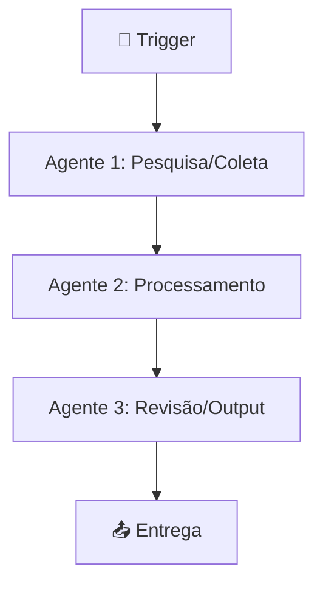

# 🚀 Crew: <% tp.file.title %>

> **Status:** `= this.status` · **Cadência:** `= this.cadencia` · **Workflow:** `= this.workflow_n8n`

---

## 🎯 Objetivo da Crew
> 

---

## 👥 Composição

| Agente | Papel na Crew | Modelo |
|--------|--------------|--------|
| | Líder | |
| | Executor | |
| | Revisor | |

---

## 🔄 Fluxo de Execução



### Detalhamento das Tasks

| # | Task | Agente | Input | Output |
|---|------|--------|-------|--------|
| 1 | | | | |
| 2 | | | | |
| 3 | | | | |

---

## ⚙️ Configuração CrewAI

```python
crew = Crew(
    agents=[],
    tasks=[],
    process=Process.sequential,  # ou hierarchical
    verbose=True,
    memory=True,
    manager_llm="",  # se hierarchical
)
```

---

## 📊 Histórico de Execuções

```dataview
TABLE WITHOUT ID
  file.link as "Execução",
  date as "Data",
  status as "Status",
  duracao as "Duração"
FROM "Logs"
WHERE contains(crew, this.nome)
SORT date DESC
LIMIT 10
```

---

## 📝 Changelog

### v1.0 — <% tp.date.now("DD/MM/YYYY") %>
- Crew criada
