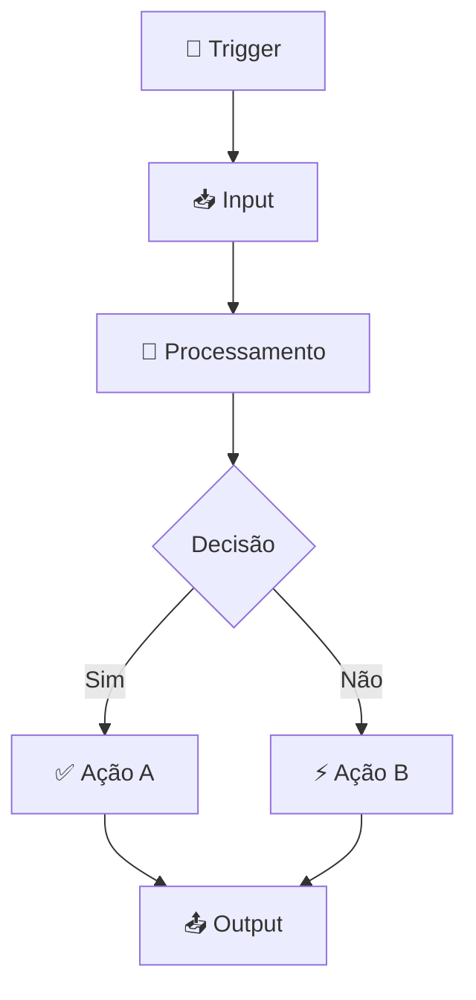

# ⚙️ Workflow: <% tp.file.title %>

> **ID:** `= this.workflow_id` · **Status:** `= this.status` · **Instância:** `= this.n8n_instancia`

---

## 📝 Descrição

**O que faz:**
> 

**Por que existe:**
> 

**Impacto no negócio:**
> 

---

## 🔄 Fluxo Visual



### Etapas Detalhadas

| # | Node | Tipo | Descrição |
|---|------|------|-----------|
| 1 | | Trigger | |
| 2 | | | |
| 3 | | | |
| 4 | | Output | |

---

## ⚙️ Configuração

| Parâmetro | Valor |
|-----------|-------|
| **Trigger** | `= this.trigger` |
| **Frequência** | `= this.frequencia` |
| **Agente principal** | `= this.agente_principal` |
| **Agentes envolvidos** | `= this.agentes_envolvidos` |
| **Ferramentas** | `= this.ferramentas` |
| **Consumo estimado** | `= this.consumo_estimado` |
| **Timeout** | s |

### Credenciais Necessárias

| Serviço | Credencial | Status |
|---------|-----------|--------|
| | | ✅ / ❌ |

### Variáveis de Ambiente

| Variável | Exemplo |
|----------|---------|
| | |

---

## 🛡️ Error Handling

| Cenário de Erro | Ação |
|-----------------|------|
| API timeout | |
| Rate limit | |
| Credencial inválida | |
| Dado inválido | |

**Fallback configurado?** Sim / Não
**Notificação de falha:** Via WhatsApp / Telegram / Email

---

## 📊 Métricas de Execução

| Métrica | Valor |
|---------|-------|
| Execuções/dia (média) | |
| Tempo médio de execução | s |
| Taxa de sucesso | % |
| Última execução | `= this.ultima_execucao` |
| Último erro | |

---

## 🧪 Checklist de Deploy

- [ ] Testado com dados simulados
- [ ] Testado com dados reais (1x manual)
- [ ] Error handling configurado em todos os nodes
- [ ] Retry configurado (3x com backoff)
- [ ] Notificação de falha ativa
- [ ] Documentação atualizada
- [ ] Credenciais configuradas e válidas
- [ ] Ativado no n8n

---

## 📝 Changelog

### v1.0 — <% tp.date.now("DD/MM/YYYY") %>
- Versão inicial

---

## 🔗 Relacionados
- Agente: [[Agentes/<% tp.file.title %>]]
- Crew: [[]]
- Dependency: [[]]

## 📋 Tarefas Executadas (Dataview)
```dataview
TABLE status AS "Status", completed_at AS "Concluído", provider AS "LLM Provider"
FROM "Tarefas"
WHERE contains(tags, this.workflow_id) OR contains(file.name, this.workflow_id)
SORT created_at DESC
LIMIT 10
```

